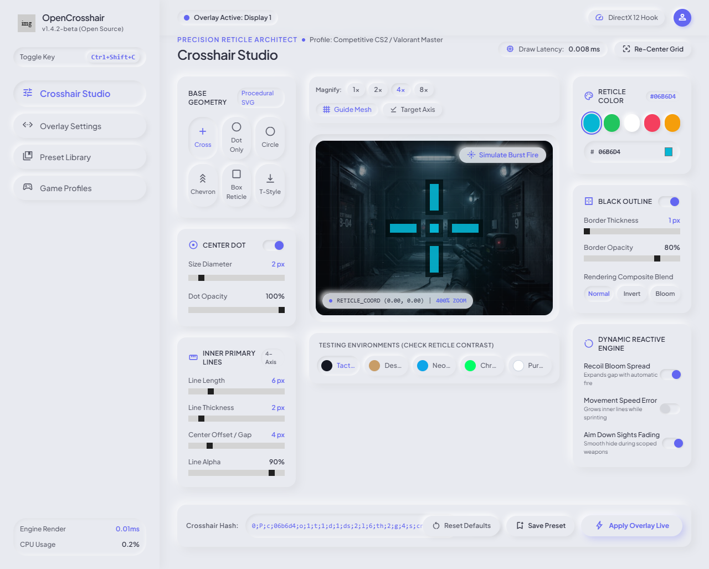
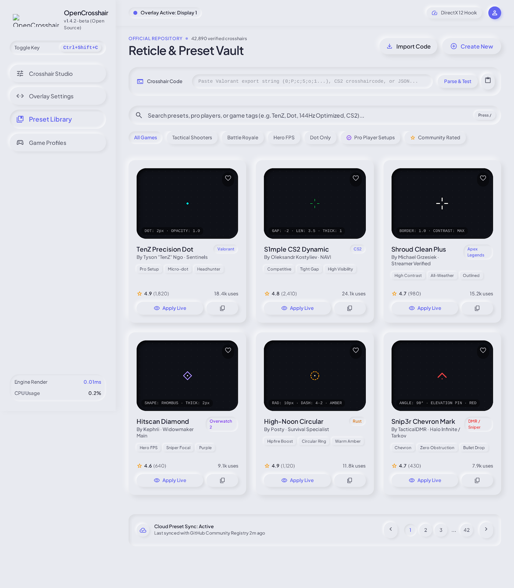
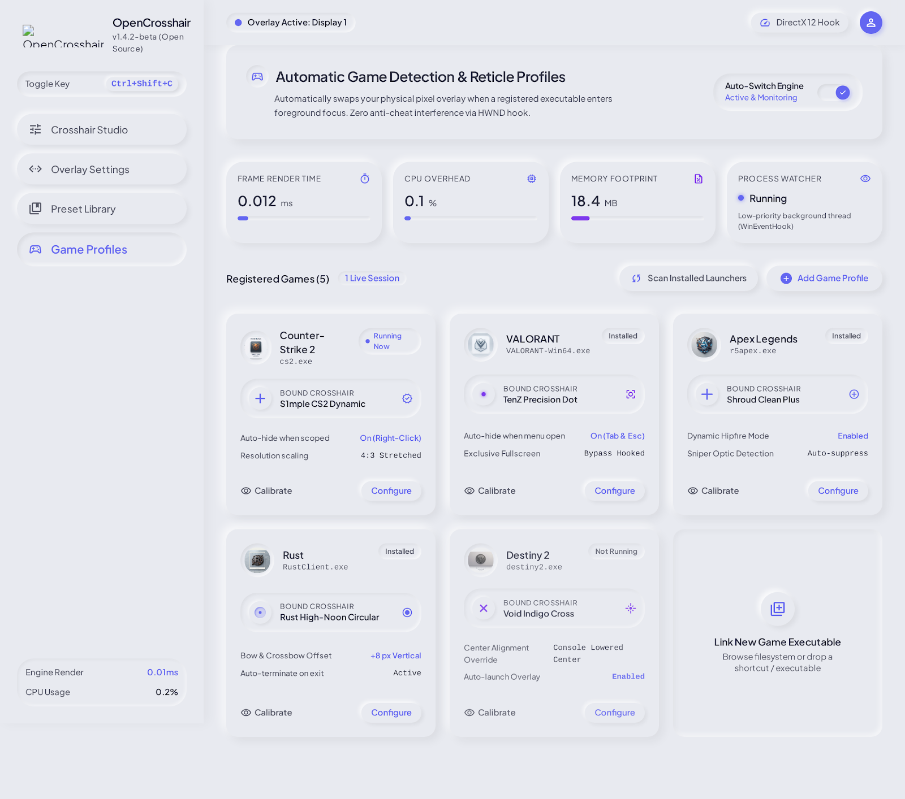
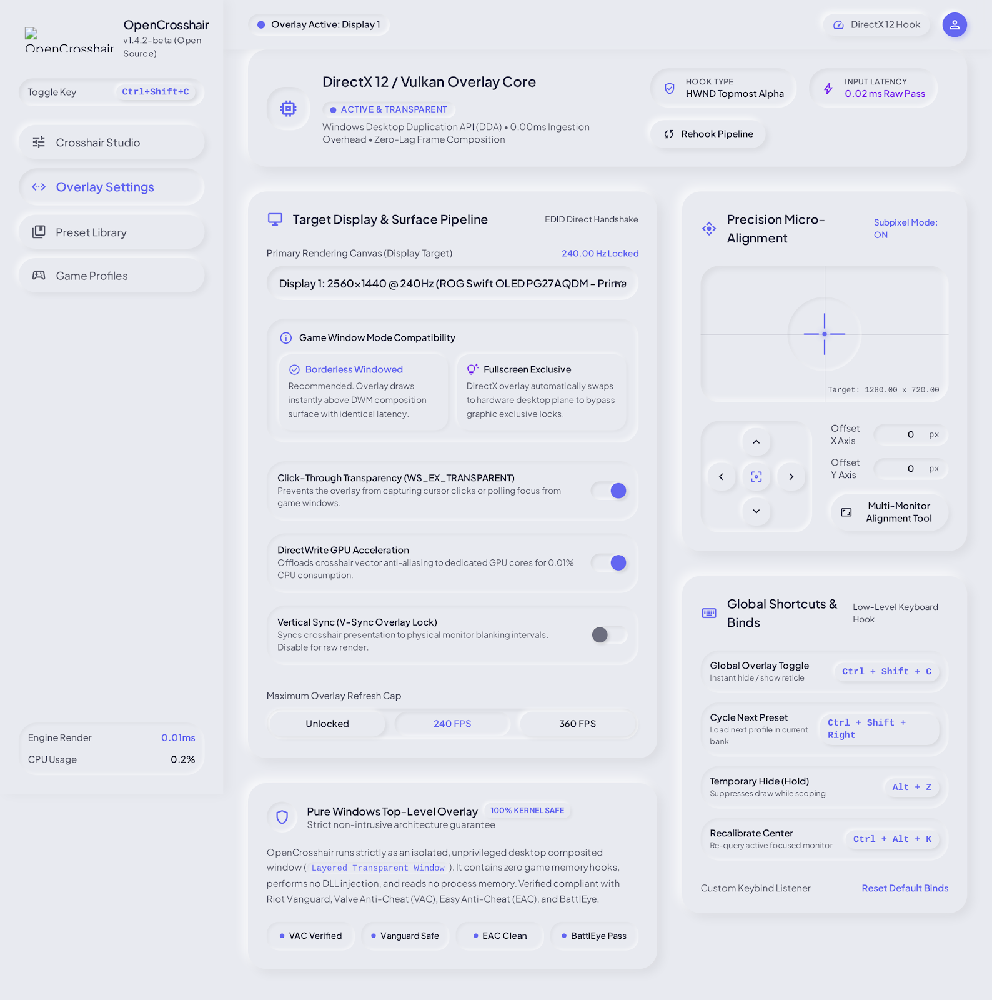

# OpenCrosshair

OpenCrosshair is a free, open-source crosshair overlay for Windows. It draws a customizable
crosshair on top of your screen, lets you keep a library of crosshair presets, and can switch
the crosshair automatically when a game you have set up comes to the foreground.

## Principles

- **Free.** MIT licensed. No paid tier, no ads, no accounts.
- **No telemetry.** OpenCrosshair does not collect usage data, crash reports or analytics.
- **Local.** Presets, profiles and settings are stored as plain JSON files on your own computer.
- **No injection.** OpenCrosshair does not inject code into other processes, does not read or
  write game memory, and does not hook game input. It draws its own separate window on top of
  the screen and checks which program is in the foreground.

## Features

- **Overlay.** A transparent, click-through, always-on-top window that draws the crosshair.
  It does not take keyboard focus from the game.
- **Editor.** Live preview with controls for shape, length (horizontal and vertical), thickness,
  gap, circle radius, dot size, rotation, X/Y offset, element toggles (lines, center dot, circle),
  colour with alpha, opacity, outline and shadow. Shapes: classic cross, center dot, circle,
  cross + dot, dot ring, T shape and chevron.
- **Positioning.** Center the crosshair on a chosen monitor, on the foreground game window, or at a
  custom screen position, with X/Y offsets.
- **Presets.** A library of crosshairs with names, categories, descriptions, favourites and a
  recently used list. Built-in presets and your own presets live side by side.
- **JSON import and export.** Export a single crosshair or a whole collection of presets to a
  versioned JSON file and import it again. The format is documented in
  [docs/FILE_FORMAT.md](docs/FILE_FORMAT.md).
- **Game profiles with auto-detect.** Assign a preset to a game by its executable file name
  (for example `cs2.exe`). When automatic switching is on, OpenCrosshair checks the foreground
  program every second or so and applies the matching preset. See [docs/PRIVACY.md](docs/PRIVACY.md)
  for exactly what is checked.
- **Global hotkeys.** Toggle the crosshair and the overlay, switch presets and toggle automatic
  profiles without leaving the game. Hotkeys can be changed in Settings.
- **System tray.** Keep OpenCrosshair running in the notification area; the tray icon gives quick
  access to the main window and to quit.
- **Optional autostart.** Off by default. You can choose to start OpenCrosshair when you sign in
  to Windows; it then starts minimized to the tray.

## Screenshots

> **Design concepts only.** The images below are exploratory UI design concepts that define the
> intended visual direction (dark theme, blue accent). They are **not** screenshots of the
> application and the shipped interface may differ from them.

| Editor concept | Preset library concept |
|---|---|
|  |  |

| Game profiles concept | Overlay settings concept |
|---|---|
|  |  |

More notes on the design direction are in [concept/README.md](concept/README.md).

## Installation

OpenCrosshair targets **Windows 10 or newer, 64-bit (x64)**. Download the latest version from the
**[Releases page](https://github.com/Pausiar/OpenCroshair/releases)**. Each release offers an
installer and a portable ZIP. Pick whichever you prefer:

- **Installer** (`setup.exe`). Installs per user into your user profile, without administrator rights.
  The installer can also install for all users, which asks for administrator rights. Optional
  extras during setup: a desktop shortcut and "Launch at startup" (unticked by default).
- **Portable ZIP**. Extract it anywhere and run `opencrosshair.exe`. Nothing is written to the
  Registry for autostart unless you enable it in Settings. Settings and presets are still stored in
  your user data folder (see below), the same as the installed version.

Uninstalling with the installer removes the program files, the shortcuts and the autostart entry. It
then asks, with "No" as the default answer, whether to also delete your data folder.

### Where data is stored

Settings, presets and game profiles are stored as JSON files under your roaming profile,
`%APPDATA%\OpenCrosshair`. Diagnostic log files are kept under `%LOCALAPPDATA%\OpenCrosshair`. Nothing is
stored in the Registry except the optional autostart entry
(`HKCU\Software\Microsoft\Windows\CurrentVersion\Run`). Nothing is sent anywhere.

## Usage

1. Start OpenCrosshair. Open the **Editor**, adjust the crosshair and press **Apply**.
2. Turn on the overlay. The crosshair appears on the monitor you selected.
3. Save useful crosshairs to the **Presets** library. Export them to JSON to share or back them up.
4. Under **Profiles**, add a game by its executable file name and choose a preset for it. Turn on
   automatic profile switching to apply the preset whenever that game is in the foreground.
5. Use the hotkeys below while playing.

Set the game to **borderless fullscreen** or **windowed** mode. Exclusive fullscreen cannot be overlaid
(see [Limitations](#limitations)).

### Default hotkeys

| Action | Default hotkey |
|---|---|
| Toggle crosshair (show / hide the crosshair) | `Ctrl+Alt+F1` |
| Toggle overlay (overlay on / off) | `Ctrl+Alt+F2` |
| Next preset | `Ctrl+Alt+Right` |
| Previous preset | `Ctrl+Alt+Left` |
| Toggle automatic game profiles | `Ctrl+Alt+F3` |

All hotkeys can be changed in **Settings > Hotkeys**. If another program already uses a hotkey,
OpenCrosshair reports the conflict in the same screen and the action does not register until you pick
a different combination.

## Building from source

Requirements: a stable Rust toolchain (edition 2024, Rust 1.85 or newer) and the MSVC build tools
for Windows (`x86_64-pc-windows-msvc`).

```powershell
cargo build --release
cargo test
```

The release binary is written to `target\release\opencrosshair.exe`. Packaging, the Inno Setup
installer and CI are described in [docs/BUILDING.md](docs/BUILDING.md).

## Project structure

```
src/
  main.rs          entry point
  app.rs           application shell (egui/eframe), owns AppState
  state.rs         shared application state
  crosshair/       data model, validation, presets, pure CPU renderer
  overlay/         Win32 layered, click-through overlay window (own thread)
  hotkeys/         global hotkey registration
  profiles/        game profiles and foreground process detection
  storage/         settings, presets, profiles on disk; JSON import/export
  system/          monitors, tray icon, autostart (HKCU Run)
  ui/              Editor, Dashboard, Presets, Profiles, Settings pages
docs/              architecture, building, testing, privacy, file format
installer/         Inno Setup script and PowerShell packaging scripts
assets/            icons and built-in preset data
concept/           UI design concepts (not the shipped UI)
.github/workflows/ CI and release pipelines
```

Architecture notes are in [docs/ARCHITECTURE.md](docs/ARCHITECTURE.md).

## Limitations

- **Exclusive fullscreen games cannot be overlaid.** Windows gives exclusive fullscreen programs
  direct control of the display, so no other window can be drawn above them. Use **borderless
  fullscreen** or **windowed** mode.
- **Anti-cheat systems may block or flag overlays.** Some games' anti-cheat software treats any
  additional window on top of the game as suspicious, even though OpenCrosshair does not touch game
  memory or input. OpenCrosshair cannot control this. If a game's anti-cheat blocks or flags the
  overlay, stop using the overlay in that game. Check the game's rules before use.
- **No bypass attempts.** OpenCrosshair will never try to get around anti-cheat, display or
  security restrictions. Contributions that do so will not be accepted.
- **Windows 10 or newer, x64 only.** There is no macOS, Linux or 32-bit build.
- **Unverified on Windows so far.** The pure logic (data model, validation, file format, renderer
  output) is covered by automated tests that run on any platform. Behaviour that depends on Windows
  (the overlay window, global hotkeys, tray, autostart, foreground process detection, multi-monitor
  and DPI handling) has **not been verified** until someone runs the manual checklist in
  [docs/TESTING.md](docs/TESTING.md) on a real Windows 10 or 11 machine and reports the result.
- **Process detection cannot see every process.** Programs running elevated (as administrator) or
  with protected status may not be identifiable, so a game profile for them will not match.
- **Hotkeys can conflict** with other programs that register the same combination.

## Contributing

See [CONTRIBUTING.md](CONTRIBUTING.md).

## Licence

OpenCrosshair is released under the MIT License. See [LICENSE](LICENSE).
